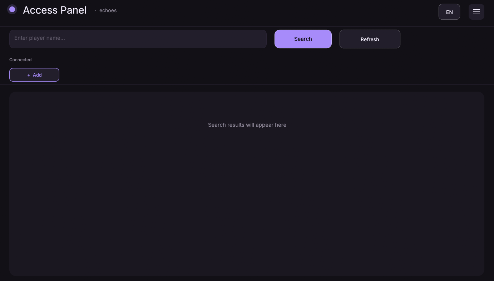
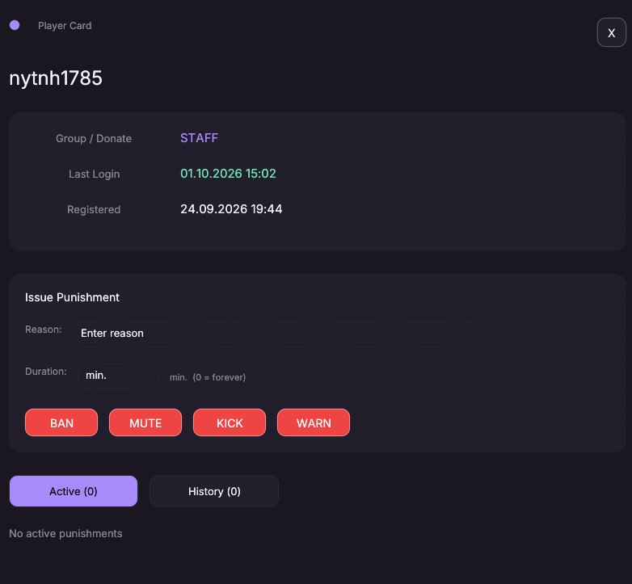
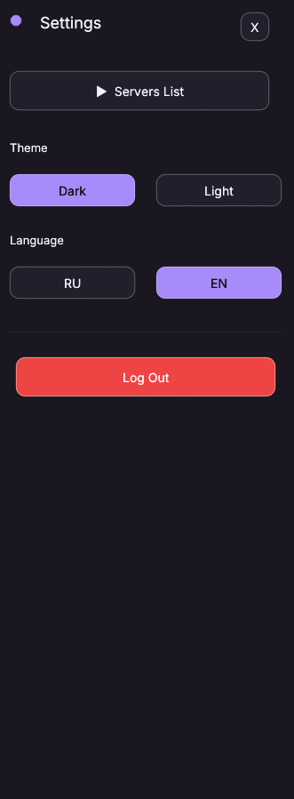

<div align="center">

# 🛡️ Access Panel

**Minecraft Server Admin Panel**

Manage players, punishments, and RCON — in one beautiful app.

[](https://www.rust-lang.org/)
[](LICENSE)
[]()
[]()

**🌍 Language:** [Русский](README.md) · [English](README.en.md)

</div>

---

## ✨ Features

<table>
<tr>
<td width="50%">

### 👥 Players
- 🔍 Search by username
- 📋 Sort by UUID / username
- 🎫 Player card: group, donation, dates
- 💾 Data from MySQL

</td>
<td width="50%">

### ⚔️ Punishments
- 🚫 BAN / MUTE / KICK / WARN
- ⏱️ Duration (0 = permanent)
- 📜 History and active
- ↩️ Remove punishment

</td>
</tr>
<tr>
<td width="50%">

### 🔌 RCON
- 📡 Server connection
- ⚡ Instant commands
- 🎯 Custom punishment templates
- 🔘 Macro buttons

</td>
<td width="50%">

### 🎨 Interface
- 🌙 Dark / ☀️ Light themes
- 🌍 Russian / English
- ✨ Smooth animations
- 🖥️ Modern design

</td>
</tr>
</table>

---

## 📸 Screenshots

<div align="center">

### Main window


### Player card


### Settings


</div>

> 💡 *Screenshots coming soon.*

---

## 🚀 Installation

### Requirements

- **Rust** 1.75+ — [install](https://rustup.rs/)
- **Minecraft server** with **RCON** enabled
- **MySQL** — for plugin data storage

### Build

```bash
# Clone repository
git clone https://github.com/NYtnhhhh/Access-Panel.git
cd Access-Panel

# Build release
cargo build --release

# Run
cargo run --release
```

The `.exe` will appear in `target/release/access_panel.exe`.

---

## ⚙️ Configuration

### First launch

On first launch, the **Welcome screen** will open. Enter:

1. **Server name** — anything you like.
2. **MySQL** — database credentials:
   - Host (`localhost` or hosting IP)
   - Port (`3306` by default)
   - User, password, database name
3. **RCON** — server credentials:
   - Host (server IP)
   - Port (`25575` by default)
   - Password

Click **Connect** — data saves to `servers.toml`.

### Minecraft server setup

In `server.properties`:

```properties
enable-rcon=true
rcon.port=25575
rcon.password=your_password
```

Restart the server — RCON is ready.

---

## 🎮 Usage

### 🔍 Search player

1. Enter username in search field.
2. Click **Search** or press **Enter**.
3. Click on username → card opens.

### ⚔️ Punishment

1. Open player card.
2. Enter **reason** and **duration**.
3. Click **BAN** / **MUTE** / **KICK** / **WARN**.

Command is sent via RCON and saved to database.

### 🔘 Macros

Below the search bar — macro buttons panel:

- **Left click** → run command.
- **Right click** → edit.
- **"+ Add"** → new macro.

Placeholder `{player}` inserts username from open card.

### 🎨 Theme and language

Open **⚙ Settings** (top right):

- **Theme:** Dark / Light
- **Language:** RU / EN

Choice is saved to `theme.txt` and `lang.txt`.

---

## 🔒 Security

> ⚠️ **File `servers.toml` contains MySQL and RCON passwords.**

It is **excluded** from Git via `.gitignore`. Never commit it!

If accidentally uploaded — **change passwords** and remove file from Git history.

---

## 🛠️ Tech Stack

| Component | Technology |
|-----------|-----------|
| Language |  |
| GUI |  |
| Database |  |
| RCON | Custom implementation |
| Format |  |

---

## 🗺️ Roadmap

- [x] MySQL connection
- [x] Player search
- [x] Player card
- [x] Punishments via RCON
- [x] Themes (Dark / Light)
- [x] Multi-language (RU / EN)
- [x] Macro buttons
- [x] Smooth animations
- [ ] Custom punishment templates
- [ ] Header statistics
- [ ] Action logs
- [ ] Server import / export
- [ ] Paper plugin
- [ ] Web version

---

## 🤝 Contributing

Pull requests are welcome!

1. Fork the repository.
2. Create a branch (`git checkout -b feature/AmazingFeature`).
3. Commit (`git commit -m 'Add some AmazingFeature'`).
4. Push (`git push origin feature/AmazingFeature`).
5. Open a Pull Request.

---

## 📄 License

Distributed under the **MIT** license. See [LICENSE](LICENSE).

---

<div align="center">

**Made with ❤️ for the Minecraft community**

[⬆ Back to top](#-access-panel)

</div>